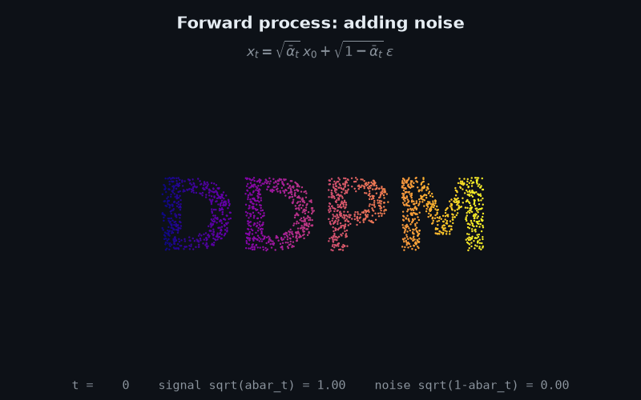
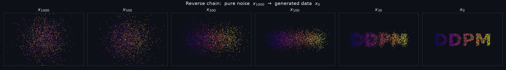
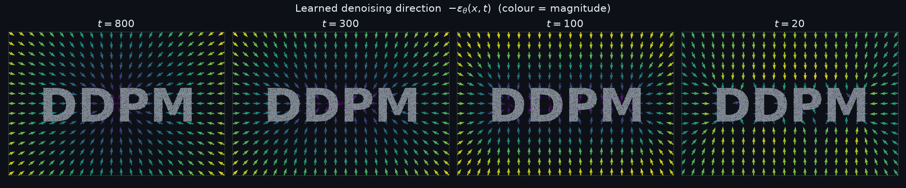
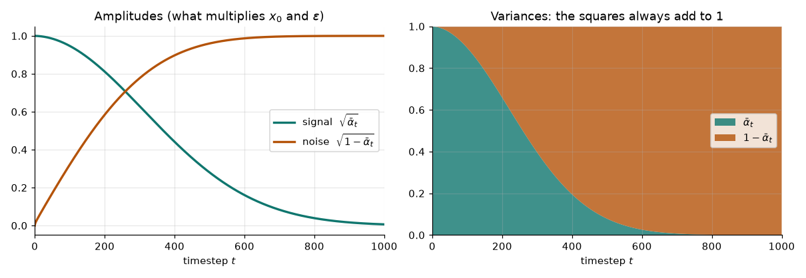
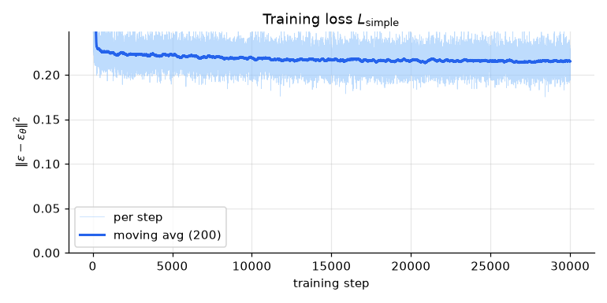

# DDPM From Scratch: watch noise turn into data

<p align="center">
  
</p>

A minimal, readable implementation of **Denoising Diffusion Probabilistic Models** ([Ho et al., 2020](https://arxiv.org/abs/2006.11239)) in plain PyTorch, written to accompany my write-up
**["Wait… DDPM Finally Makes Sense! A mathematical derivation, one coefficient at a time"](https://medium.com/@cucachen89/wait-ddpm-finally-makes-sense-be15cecec486)**.

Read the full derivation on [Medium](https://medium.com/@cucachen89/wait-ddpm-finally-makes-sense-be15cecec486) or download the [PDF version](DDPM-Mathematical-Derivation.pdf).

Each "image" here is a single 2-D point, so the whole data distribution fits on one plot and you can
*see* every step of the algorithm. The math is identical to image DDPM; only the network is smaller.
Training takes a few minutes on a laptop CPU, with no GPU needed.

## From equation to code

The core is [`ddpm.py`](ddpm.py) (about 100 lines). Each equation from the derivation maps to one line of code:

| Derivation | Equation | Code |
|---|---|---|
| Forward step (§2, Eq. 4) | $x_t=\sqrt{\alpha_t}\,x_{t-1}+\sqrt{1-\alpha_t}\,\epsilon_t$ | `DDPM.q_step` |
| Forward shortcut (§4, Eq. 11) | $x_t=\sqrt{\bar\alpha_t}\,x_0+\sqrt{1-\bar\alpha_t}\,\epsilon$ | `DDPM.q_sample` |
| Posterior variance (§5, Eq. 21) | $\tilde\beta_t=\frac{1-\bar\alpha_{t-1}}{1-\bar\alpha_t}\beta_t$ | `DDPM.tilde_betas` |
| Model mean (§6, Eq. 27) | $\mu_\theta=\frac{1}{\sqrt{\alpha_t}}\big(x_t-\frac{\beta_t}{\sqrt{1-\bar\alpha_t}}\epsilon_\theta(x_t,t)\big)$ | `DDPM.p_mean` |
| Sampling step (§7, Eq. 29) | $x_{t-1}=\mu_\theta(x_t,t)+\sigma_t z$ | `DDPM.p_step` |
| Training loss (§8, Eq. 30) | $\lVert\epsilon-\epsilon_\theta(\sqrt{\bar\alpha_t}x_0+\sqrt{1-\bar\alpha_t}\epsilon,\,t)\rVert^2$ | `DDPM.loss` |

The schedule tensors are indexed by $t=0,1,\dots,T$ with a dummy entry at $t=0$ ($\beta_0=0,\ \bar\alpha_0=1$),
so `ddpm.betas[t]` really is $\beta_t$ and the code reads exactly like the paper.

Training (Algorithm 1) is just this:

```python
t   = torch.randint(1, T + 1, (B,))          # t ~ Uniform{1, ..., T}
eps = torch.randn_like(x0)                   # eps ~ N(0, I)
x_t = sqrt(abar[t]) * x0 + sqrt(1 - abar[t]) * eps
loss = ((eps - model(x_t, t)) ** 2).mean()
```

Sampling (Algorithm 2) is just this:

```python
x = torch.randn(shape)                       # x_T ~ N(0, I)
for t in range(T, 0, -1):
    mean = (x - beta[t] / sqrt(1 - abar[t]) * model(x, t)) / sqrt(alpha[t])
    x = mean + sigma[t] * torch.randn_like(x) if t > 1 else mean
```

## Check the math before trusting the code

[`sanity_check.py`](sanity_check.py) verifies the derivation numerically, without any training:

```
$ python sanity_check.py
1) Variance budget (Section 2): unit variance stays unit variance
   t=1000  Var(x_t) = 1.000
2) Forward shortcut (Eq. 11) matches running the chain step by step (Eq. 4)
   t= 500  chain: mean +0.562 var 0.921  | shortcut: mean +0.564 var 0.920  | theory: mean +0.561 var 0.921
3) Posterior mean: x_0 form (Eq. 22) == noise form (Eq. 26)
   t=  50  max difference = 2.44e-15
4) End of the chain: abar_T = 4.04e-05, so x_T is almost pure N(0, I) noise
```

## Results

**The reverse chain.** Pure noise $x_{1000}$ slowly turns into the letters. Most of the shape only appears in the last ~150 steps.



**What the network learned.** Arrows show $-\epsilon_\theta(x,t)$, the direction a noisy point gets pushed.
At large $t$ everything is pulled toward the centre of the data. At small $t$ the field snaps onto the letter strokes.



**The noise schedule.** The signal amplitude $\sqrt{\bar\alpha_t}$ shrinks while the noise amplitude
$\sqrt{1-\bar\alpha_t}$ grows, and their squares always add to one (the semicircle picture from §2 of the write-up).



**Training.** The loss never reaches zero. From a noisy $x_t$ the exact noise is not fully determined (many $x_0$ could have produced it), so $\epsilon_\theta$ can only learn its average. That is exactly what the reverse step needs.



## Run it

```bash
pip install -r requirements.txt
python sanity_check.py                 # verify the equations numerically
python train.py                        # train on the word "DDPM" (uses CUDA / Apple MPS / CPU automatically)
python animate.py                      # write the GIF and figures to assets/
```

Try other shapes:

```bash
python train.py --dataset text --text HELLO && python animate.py --dataset text
python train.py --dataset swissroll && python animate.py --dataset swissroll
```

## Files

| File | What it does |
|---|---|
| [`DDPM-Mathematical-Derivation.pdf`](DDPM-Mathematical-Derivation.pdf) | Full mathematical derivation |
| [`ddpm.py`](ddpm.py) | Noise schedule, forward process, loss, and sampler. **Start here.** |
| [`model.py`](model.py) | $\epsilon_\theta(x_t,t)$: a small residual MLP with a sinusoidal timestep embedding |
| [`data.py`](data.py) | 2-D datasets: points inside the letters of a word, swiss roll, two moons |
| [`train.py`](train.py) | Algorithm 1 |
| [`animate.py`](animate.py) | GIF and figures |
| [`sanity_check.py`](sanity_check.py) | Numerical checks of the derivation |

## Setup used

$T=1000$, linear $\beta_t$ from $10^{-4}$ to $0.02$ and $\sigma_t^2=\beta_t$ (all as in Ho et al.);
Adam, learning rate $10^{-3}$ with cosine decay, batch 2048, 30k steps (about 5–8 minutes on a MacBook, CPU or MPS; the model is too small for a GPU to help much).

## References

- J. Ho, A. Jain, P. Abbeel. *Denoising Diffusion Probabilistic Models.* NeurIPS 2020. [arXiv:2006.11239](https://arxiv.org/abs/2006.11239)
- A. Nichol, P. Dhariwal. *Improved Denoising Diffusion Probabilistic Models.* ICML 2021. [arXiv:2102.09672](https://arxiv.org/abs/2102.09672)
